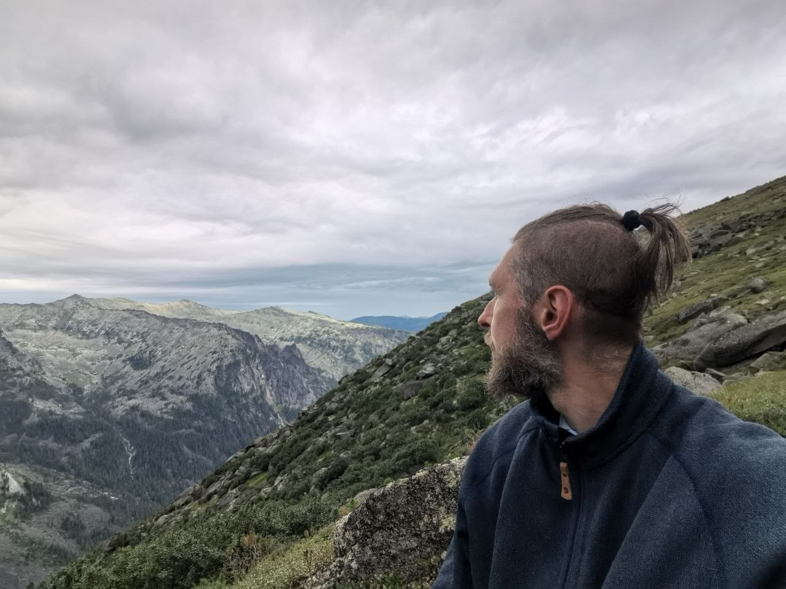

# Домашнее задание к лекции «Командная работа в Git & GitHub. Часть 2.» #
___
## О себе ##

* Меня зовут ***Владислав***, мне **34** года\
* Живу в городе ***Обнинск***\
* Занимаюсь фронтенд разработкой на ***Angular***
* В свободное время хожу в походы и занимаюсь видеосъемкой и монтажем